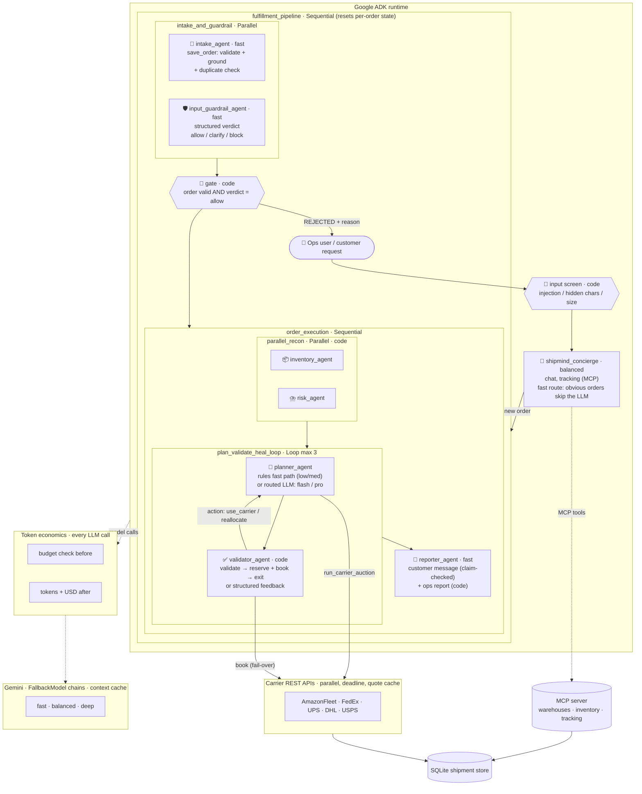
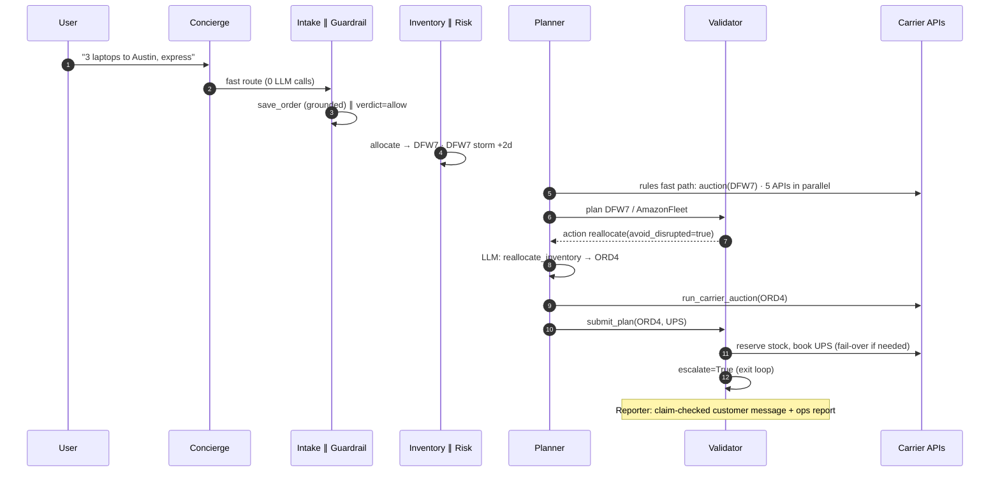

# 🚚 ShipMind: Self-Healing Logistics Control Tower

**A multi-model, multi-agent system on Google ADK that takes an order from "ship this" to "booked, labelled, customer notified" with no human in the loop, repairs itself when carriers, models or plans fail, and refuses to act on anything it can't ground in what the user actually asked for.**

Runs fully offline in mock mode (no API key) and on live Gemini with one key from Google AI Studio.

```bash
pip install -r requirements.txt && python demo_server.py    # dashboard on http://localhost:8080
```

---

## 1. Problem statement: the Logistics Handler

A company shipping at Amazon scale processes millions of orders a day. For **each** order, someone (or something) must:

1. **Understand the request**: SKU, quantity, destination, delivery promise.
2. **Allocate inventory** across a network of fulfillment centers, sometimes splitting the order.
3. **Check live risk**: storms, labor shortages and outages that silently add days.
4. **Pick a carrier** among several, each with its own API, price, speed, weight limits and reliability.
5. **Guarantee the SLA** (express 2 d, standard 5 d, economy 8 d) at the lowest cost.
6. **Book it**, then survive the reality that carrier APIs time out, rate-limit and go down.
7. **Tell the customer** and leave an audit trail for ops.

Today this is a chain of brittle rules engines plus human exception queues. The cheapest carrier gets picked and misses the SLA; a storm closes a warehouse and orders keep routing into it; a carrier API returns 503 and the order sits in a retry queue for hours.

**Goal:** automate the whole chain end to end, with minimal latency and cost, make failures heal themselves instead of paging a human, and never ship something the customer didn't ask for.

## 2. Solution: what's out of the box

| Idea | What it does |
|---|---|
| **Layered guardrails** | A deterministic input screen (injection, hidden characters, oversize), a separate **LLM guardrail agent** that judges each request (`allow` / `clarify` / `block`) in parallel with intake, strict field validation, and a **grounding check** that every order field appears in the user's own words. Execution runs only if code *and* model both agree. |
| **Anomaly detection** | Unknown products/cities, negative/fractional/absurd quantities, several products in one message, contradictory deadlines, price manipulation and duplicate order ids are **rejected with a reason**, never silently "fixed" (2.7 → 2, Gotham → Seattle). |
| **Grounded outputs** | Every tracking id, price, ETA, carrier and "it shipped" claim in the customer message is checked against the booked shipments before it is sent; the ops report is generated from state by code. |
| **Agent evals** | `python -m evals.run_evals` scores **groundedness, truthfulness, hallucination rate, anomaly recall, false rejects, cost and latency** on 17 scenarios and fails CI on regression. Also exports an ADK evalset for `adk eval` (`hallucinations_v1`). |
| **Token economics** | Per-order, per-agent token + USD accounting, a hard **token budget** per order, automatic deep→balanced downgrade near the budget, compact JSON context instead of chat history, ADK context caching on live Gemini. |
| **Execution optimisation** | ~3 LLM calls per routine order (was ~16): deterministic recon + validator agents, a rules **fast path** for low/medium-complexity planning, a fast route past the concierge, parallel intake ∥ guardrail, async tools, parallel auctions and bookings, a short-TTL quote cache, auction deadlines. |
| **Carrier auction** | Every leg fires *all* carrier rate APIs **in parallel**, then scores them by price, ETA and reliability with weights that depend on the delivery promise. Anomalous quotes (negative price, impossible ETA) are dropped. |
| **Plan → Validate → Heal loop** | The validator returns **machine-readable actions** (`use_carrier`, `reallocate`, `rerun_auction`, `escalate`) so the feedback loop never depends on parsing prose. Escalates on unhealable issues, on a re-plan that made no progress, or on the last pass. |
| **Self-healing at 6 layers** | Jittered retry → circuit breaker (single half-open probe) → carrier fail-over → re-planning → model fallback chain → rules engine. |
| **Correct under concurrency** | Atomic stock reservation at booking (no overselling), idempotent dispatch per order + origin (no double booking), SQLite shipment store shared safely with the MCP server process. |
| **MCP as the integration bus** | Warehouse, inventory, disruption and tracking systems are an MCP server, so any MCP client (ADK, Claude, an IDE) can use them. |
| **Chaos-tested** | `SHIPMIND_CHAOS_RATE=0.3` makes 30% of carrier *and* model API calls fail, deterministically. |

## 3. Architecture



### One order, API by API



More detail (state contract, latency budget, scaling path) in [`docs/ARCHITECTURE.md`](docs/ARCHITECTURE.md).

## 4. Guardrails and anomaly detection

| Layer | Kind | Catches | Where |
|---|---|---|---|
| Input screen | code, before any LLM | prompt injection, hidden/control characters, oversized input | `core/guards.py` · `screen_user_text` |
| Input guardrail agent | **LLM judge**, parallel with intake | fraud / price manipulation, out-of-catalog asks, contradictions, anything ambiguous → `clarify` | `input_guardrail_agent` · `GuardrailVerdict` schema |
| Field validation | code | non-integer / negative / absurd quantity, unknown sku/city/priority, malformed order id | `core/logistics.py` · `normalize_order` |
| Grounding check | code | an order field the user never said (LLM guessed a default, substituted a city, dropped a minus sign), several products in one message | `core/guards.py` · `grounding_issues` |
| Duplicate detection | code | an order id that was already dispatched | `normalize_order` + store |
| Execution gate | code | runs the pipeline only if the order is valid **and** the guardrail said `allow`; fails closed if the guardrail model is down | `require_valid_order` |
| Plan validation | code | duplicate / negative legs, stale quotes, unknown origins, SLA misses, stock | `validate_plan` |
| Output claim check | code | invented tracking ids, prices, ETAs, carriers, "it shipped" when it didn't | `core/claims.py` in `notify_customer` |

Rejected orders end with `outcome.status = REJECTED` and the reason (e.g. `quantity: user wrote -3, which is not a valid quantity`).

## 5. Agent evals: groundedness, truthfulness, hallucinations

```bash
python -m evals.run_evals                 # mock LLM, deterministic, exits 1 if the quality gate fails (CI)
python -m evals.run_evals --live --judge  # live Gemini + an LLM-as-judge second opinion (spends tokens)
python -m evals.run_evals --export-adk evals/shipmind.evalset.json
adk eval logistics_agent evals/shipmind.evalset.json --config_file_path evals/test_config.json
```

17 scenarios in [`evals/cases.py`](evals/cases.py): normal orders, storm reallocation, split heavy freight, aliases and number words, 40% chaos, backorder escalation, and 11 adversarial or anomalous inputs. Every metric compares agent output to the **system of record** (engine state, shipment store, inventory):

| Metric | Definition | Gate |
|---|---|---|
| groundedness | order fields traceable to the user's words + customer-message claims traceable to booked shipments | ≥ 0.95 |
| truthfulness | expected outcome, store matches dispatch, no stray or duplicate bookings, rejected orders not booked, no negative stock | ≥ 0.95 |
| hallucination rate | unsupported claims / all claims | ≤ 0.02 |
| anomaly recall | anomalous inputs that were rejected | = 1.0 |
| false reject rate | valid orders that were rejected | ≤ 0.05 |
| accuracy, LLM calls, tokens, cost, p50/p95 latency | per case and aggregate | accuracy ≥ 0.95 |

Current mock run: accuracy 1.0 · groundedness 1.0 · truthfulness 1.0 · hallucination rate 0 · anomaly recall 1.0 · false rejects 0 · 3.1 LLM calls/order on average. Results are written to `evals/results/latest.json`.

## 6. Token economics

- **Accounting:** an `after_model_callback` on every LLM agent records input / output / cached tokens and USD per agent per order (state keys `tokens_<agent>`; `economics.order_usage(state)` aggregates). `run_agent.py`, the dashboard and the evals print it.
- **Budget:** `SHIPMIND_TOKEN_BUDGET_PER_ORDER` (default 60k). A `before_model_callback` refuses further calls past the budget (schema-valid `block` for the guardrail), so a confused loop escalates instead of burning money. Past `SHIPMIND_BUDGET_DOWNGRADE_AT` (60%) the planner drops from the deep model to the balanced one.
- **Fewer, smaller calls:** deterministic agents where no judgment is needed; `include_contents="none"` plus compact `CONTEXT_JSON` instead of the whole chat history; tools that finish the turn (`skip_summarization`) instead of a second "summarise the tool result" call; ops report built by code.
- **Caching:** ADK `context_cache_config` on live Gemini (per-agent cached prefixes); `SHIPMIND_CACHED_INPUT_DISCOUNT` prices cached tokens.
- **Prices:** `SHIPMIND_MODEL_PRICES` (USD per 1M tokens per tier). The defaults are illustrative; set your contract prices. Mock mode estimates tokens at ~4 chars/token so the whole layer is exercised offline.

| Order type | LLM calls before | LLM calls now |
|---|---|---|
| routine (low/medium complexity) | ~16 | **3** (intake ∥ guardrail, reporter) |
| storm re-plan | ~20 | 7 |
| high complexity (deep planner) | ~16 | 6 |

## 7. Self-healing matrix

| Failure | Detected by | Healing action | Where |
|---|---|---|---|
| Carrier API 429/503/timeout | `CarrierAPIError` | Retry with jittered backoff ~20→40 ms | `core/healing.py` |
| Carrier keeps failing | 3 consecutive failures | Circuit opens; after 5 s exactly one probe tests recovery | `core/healing.py` |
| Carrier too slow | auction deadline | Dropped from this auction, counts as a failure | `carrier_auction` |
| Carrier returns garbage | `quote_anomaly` | Quote discarded, never ranked or booked | `carrier_auction` |
| Booking fails after retries | `dispatch()` | Fail over to next SLA-compliant carrier; stock released | `core/logistics.py` |
| Two orders race for the last units | atomic reservation | Loser gets `stock_conflict`, never oversells | `_reserve` |
| Same order dispatched twice | store lookup | Existing shipment returned, no second booking | `dispatch` |
| Plan misses SLA / wrong qty / stale quote | `validate_plan` | Structured action → planner re-plans | validator |
| Origin hit by a storm | `sla_breach_origin` | `reallocate(avoid_disrupted=true)` | planner |
| Re-plan made no progress / last pass | `review_plan` | Escalate with a reason | validator |
| Order impossible | `healable=false` | Escalate on the first pass | validator |
| Gemini 429/5xx/504 | ADK `FallbackModel` | Next model in the chain answers | `model_router.py` |
| Hung model call | `SHIPMIND_LLM_TIMEOUT_S` | Call times out instead of stalling the order | `agent.py` |
| Over token budget | `enforce_budget` | No more model calls; order escalates | `economics.py` |
| Bad LLM tool arguments | tool returns `valid_options` | LLM fixes formatting and retries (max 3) | `save_order` |
| Every model down | sim | Degrade to deterministic rules engine | `simulate.py` |

## 8. Multi-model routing

| Agent | Kind | Model | Why |
|---|---|---|---|
| concierge | LLM | balanced | Conversation, tracking questions; obvious new orders are fast-routed with no call |
| intake, input guardrail | LLM, parallel | fast | Extraction and judgment on short input; run concurrently |
| planner | rules or LLM | **fast path** for low/medium; balanced, or deep when complexity = high | Pay for reasoning only on re-plans and hard orders |
| reporter | LLM | fast | Customer-facing wording (claim-checked) |
| inventory, risk, validator | code | none | Pure policy: instant, exact, can't be talked out of a check |

Every tier is a fallback chain (`deep → balanced → fast`). Any tier also accepts a LiteLLM id (e.g. `openai/gpt-4o-mini`). Model IDs are env vars: check the model list in AI Studio and override in `.env` if one isn't enabled for your key.

## 9. Quick start

```bash
git clone https://github.com/gayathriramanesh/agentWar.git && cd agentWar/shipmind
python3 -m venv .venv && source .venv/bin/activate      # Windows: .venv\Scripts\activate
pip install -r requirements.txt
cp .env.example .env                                     # optional: add GOOGLE_API_KEY

python demo_server.py                       # demo dashboard → http://localhost:8080
python -m pytest -q                         # 43 tests: engine, guards, MCP, full ADK pipeline, eval gate
python -m evals.run_evals                   # groundedness / truthfulness / hallucination evals
python run_agent.py                         # 3 scenarios with trace, tokens and cost
SHIPMIND_CHAOS_RATE=0.3 python run_agent.py # same, with 30% of API + model calls failing
python simulate.py --orders 1000 --workers 64 --chaos 0.35   # scale test
adk web --port 8000 .                       # ADK dev UI → choose "logistics_agent"
```

`make test`, `make eval`, `make eval-live`, `make ui`, `make demo`, `make chaos`, `make sim` wrap the same commands.

**Demo dashboard.** `python demo_server.py` opens a dispatch board at <http://localhost:8080>: pick a preset order (or type your own, including anomalous ones), set an API-failure rate, and watch the order travel the agent route live, intake and guardrail side by side. The heal loop lights up amber when the validator sends a plan back; the result prints as a shipping label with the LLM calls, tokens and cost, or the rejection reason. The scale panel runs up to 2,000 concurrent orders.

**Mock vs live.** With no `GOOGLE_API_KEY`, a scripted LLM drives the **real** ADK runtime: transfers, parallel agents, loop escalation, MCP subprocess calls and carrier APIs are all real; only the reasoning is scripted. Add a key and the same graph runs on Gemini. Force either with `SHIPMIND_MOCK_LLM=true|false`. The eval runner always uses mock unless you pass `--live`, so a key in `.env` never turns CI into paid model calls.

### API keys (Google AI Studio)
1. Open <https://aistudio.google.com/apikey> → **Create API key**.
2. Put it in `.env` as `GOOGLE_API_KEY=...` with `GOOGLE_GENAI_USE_VERTEXAI=FALSE`.
3. Never commit `.env` (it's in `.gitignore`). Each teammate uses their own key to avoid sharing one rate limit.

### Configuration
All knobs are env vars (see [`.env.example`](.env.example)) and are validated at startup: guardrails (`SHIPMIND_MAX_UNITS_PER_ORDER`, `SHIPMIND_GUARDRAIL_FAIL_OPEN`), execution (`SHIPMIND_FASTPATH_MAX_COMPLEXITY`, `SHIPMIND_FAST_ROUTE`, `SHIPMIND_QUOTE_CACHE_TTL_S`, `SHIPMIND_AUCTION_TIMEOUT_MS`, `SHIPMIND_LLM_TIMEOUT_S`) and token economics (`SHIPMIND_TOKEN_BUDGET_PER_ORDER`, `SHIPMIND_BUDGET_DOWNGRADE_AT`, `SHIPMIND_MODEL_PRICES`).

### Using Google Antigravity
Open the repo folder as a workspace. [`AGENTS.md`](AGENTS.md) holds the rules for coding agents (architecture, invariants, commands); point the agent at it before asking for changes. Run `make test` in the integrated terminal after every agent edit.

## 10. Measured results

| Run | Result |
|---|---|
| `pytest` | 43 passed (no API key) |
| `evals.run_evals` (mock) | 17/17 correct · groundedness 1.0 · truthfulness 1.0 · hallucination 0 · anomaly recall 1.0 |
| `run_agent.py`, 3 scenarios | 3/3 dispatched · 3 / 7 / 6 LLM calls · first order ~0.4 s incl. MCP start |
| `run_agent.py`, 30% chaos | 3/3 dispatched · retries, carrier fail-over and model fallback all fire |
| `simulate.py` 1000 orders, 35% chaos | 96% dispatched, rest correctly escalated · ~350 orders/s · p50 ≈ 150 ms · p95 ≈ 380 ms (was ~150 orders/s, p95 ≈ 650 ms) |
| `evals.run_evals --live` (one run, Gemini) | ~2.9 LLM calls and ~4k tokens per order · p50 ≈ 7 s, dominated by model latency · a 504 on the fast model was healed by `FallbackModel` |

Mock-mode latencies measure the system, not the model. On live Gemini, wall time is dominated by sequential model round-trips, which is why cutting a routine order to two sequential LLM steps (intake ∥ guardrail, then reporter) matters most.

## 11. Repository layout

```
shipmind/
├── logistics_agent/        # Google ADK app (root_agent + app)
│   ├── agent.py            # agent graph, gates, economics callbacks, context caching
│   ├── workflow_agents.py  # deterministic agents (inventory, risk, validator), guardrail schema,
│   │                       # gates, fast route, rules fast-path planner
│   ├── economics.py        # token / cost accounting and budget enforcement
│   ├── prompts.py          # instructions + CONTEXT_JSON instruction providers
│   ├── tools.py            # ADK tools (async where they do I/O) + claim-checked notify
│   ├── model_router.py     # FallbackModel chains + complexity / budget routing
│   └── mock_llm.py         # scripted LLM for offline runs (with token estimates)
├── core/                   # framework-free engine shared by everything
│   ├── logistics.py        # allocation, auction, validation, reservation, dispatch, review policy
│   ├── guards.py           # input screening, strict parsing, grounding check
│   ├── claims.py           # output claim extraction + verification
│   ├── carrier_apis.py     # mock carrier REST APIs + chaos injection
│   ├── healing.py          # jittered retry, circuit breaker, heal log
│   ├── store.py            # SQLite shipment store (shared with the MCP server)
│   └── data.py · config.py
├── evals/                  # cases, metrics, harness, CLI, ADK eval config
├── mcp_server/server.py    # MCP server (warehouse / inventory / tracking)
├── demo_server.py · demo/  # dashboard
├── run_agent.py            # ADK runner with live trace, tokens and cost
├── simulate.py             # scale + chaos simulator (same review policy as the validator)
├── tests/                  # engine, guards, MCP, end-to-end ADK, eval gate
├── docs/ARCHITECTURE.md
├── TEAM_PLAN.md
└── AGENTS.md
```

## 12. Path to production
Swap `core/data.py` and `core/carrier_apis.py` for real WMS/TMS and carrier SDKs (the interfaces stay the same). Move inventory into the shared store too: today the MCP server process has its own in-memory copy, so its stock answers don't reflect bookings made by the agent process. Move the MCP server to streamable HTTP, persist sessions with `DatabaseSessionService`, and deploy to Vertex AI Agent Engine or Cloud Run behind a Pub/Sub order queue. Run `evals.run_evals --live --judge` on a schedule and on every model change.

## Team
See [`TEAM_PLAN.md`](TEAM_PLAN.md) for roles, the minute-by-minute plan and the demo script.
