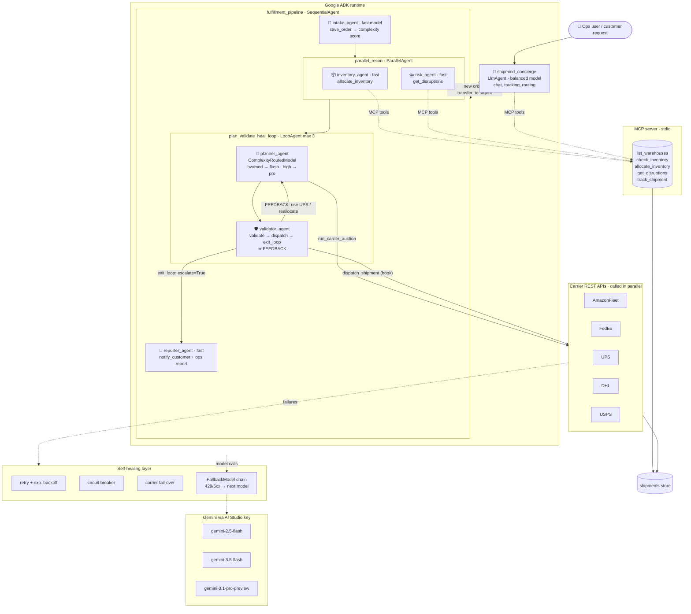
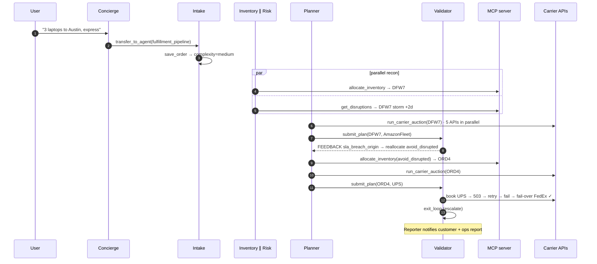

# 🚚 ShipMind: Self-Healing Logistics Control Tower

**A multi-model, multi-agent system on Google ADK that takes an order from "ship this" to "booked, labelled, customer notified" with no human in the loop, and repairs itself when carriers, models or plans fail.**

Runs fully offline in mock mode (no API key) and on live Gemini with one key from Google AI Studio.

```bash
pip install -r requirements.txt && python demo_server.py    # dashboard on http://localhost:8080
```

---

## 1. Problem statement: the Logistics Handler

A company shipping at Amazon scale processes millions of orders a day. For **each** order, someone (or something) must:

1. **Understand the request**: SKU, quantity, destination, delivery promise.
2. **Allocate inventory** across a network of fulfillment centers, sometimes splitting the order.
3. **Check live risk**: storms, labor shortages and outages that silently add days.
4. **Pick a carrier** among several, each with its own API, price, speed, weight limits and reliability.
5. **Guarantee the SLA** (express 2 d, standard 5 d, economy 8 d) at the lowest cost.
6. **Book it**, then survive the reality that carrier APIs time out, rate-limit and go down.
7. **Tell the customer** and leave an audit trail for ops.

Today this is a chain of brittle rules engines plus human exception queues. The cheapest carrier gets picked and misses the SLA; a storm closes a warehouse and orders keep routing into it; a carrier API returns 503 and the order sits in a retry queue for hours.

**Goal:** automate the whole chain end to end, with minimal latency, and make failures heal themselves instead of paging a human.

## 2. Solution: what's out of the box

| Idea | What it does |
|---|---|
| **Carrier auction** | Every leg fires *all* carrier rate APIs **in parallel** (≈40 ms total, not 5×40), then scores them by price, ETA and reliability with weights that depend on the delivery promise. |
| **Plan → Validate → Heal loop** | The planner proposes, a separate validator agent enforces hard constraints, and its structured feedback ("use UPS", "reallocate away from DFW7") drives the next iteration. Infeasible orders escalate on the **first** pass instead of looping. |
| **Complexity-routed multi-model** | A deterministic complexity score (express, split shipment, disrupted origin, heavy freight) routes the planner to the **deep** model only when it matters; routine orders use **flash** models. Cross-vendor validator supported via LiteLLM. |
| **Self-healing at 5 layers** | API retry with backoff → circuit breaker → carrier fail-over → plan re-planning → model fallback chain → graceful degradation to a rules engine. |
| **MCP as the integration bus** | Warehouse, inventory, disruption and tracking systems are an MCP server, so any MCP client (ADK, Claude, an IDE) can use them. Auto-falls back to in-process tools if MCP fails. |
| **Chaos-tested** | `SHIPMIND_CHAOS_RATE=0.3` makes 30% of carrier *and* model API calls fail, deterministically, so you can demo resilience live. |

## 3. Architecture



### One order, API by API



More detail (state contract, latency budget, scaling path) in [`docs/ARCHITECTURE.md`](docs/ARCHITECTURE.md).

## 4. Self-healing matrix

| Failure | Detected by | Healing action | Where |
|---|---|---|---|
| Carrier API 429/503/timeout | `CarrierAPIError` | Retry, backoff 20→40 ms | `core/healing.py` |
| Carrier keeps failing | 3 consecutive failures | Circuit opens, carrier skipped, half-open probe after 5 s | `core/healing.py` |
| Booking fails after retries | `dispatch()` | Fail over to next SLA-compliant carrier | `core/logistics.py` |
| Plan misses SLA / wrong qty / dead quote | `validate_plan` | Structured feedback → planner re-plans | `LoopAgent` |
| Origin hit by a storm | `sla_breach_origin` | Re-allocate with `avoid_disrupted=true` | planner |
| Order impossible (no stock / no SLA-safe site) | `healable=false` | Escalate on the first pass | validator |
| Gemini 429/5xx | ADK `FallbackModel` | Next model in the chain answers | `model_router.py` |
| Bad LLM tool arguments | tool returns `valid_options` | LLM corrects and retries the call | `save_order` |
| MCP server won't start | exception at build | In-process tools (same code) | `agent.py` |
| Every model down | sim | Degrade to deterministic rules engine | `simulate.py` |

## 5. Multi-model routing

| Agent | Tier | Default model | Why |
|---|---|---|---|
| intake, inventory, risk, reporter | fast | `gemini-2.5-flash` | Extraction and summarising; latency matters most |
| concierge | balanced | `gemini-3.5-flash` | Conversation + routing |
| planner | **routed** | flash, or `gemini-3.1-pro-preview` when complexity = high | Pay for deep reasoning only on split/disrupted/heavy orders |
| validator | validator | `gemini-3.5-flash` or any LiteLLM model | Independent second opinion; can be a different vendor |

Every tier is a fallback chain (`deep → balanced → fast`). Model IDs are env vars: check the model list in AI Studio and override in `.env` if one isn't enabled for your key.

## 6. Quick start

```bash
git clone <this-repo> && cd shipmind
python3 -m venv .venv && source .venv/bin/activate      # Windows: .venv\Scripts\activate
pip install -r requirements.txt
cp .env.example .env                                     # optional: add GOOGLE_API_KEY

python demo_server.py                       # demo dashboard → http://localhost:8080
python -m pytest -q                         # 10 tests incl. full ADK pipeline + MCP handshake
python run_agent.py                         # 3 scenarios through the real ADK runtime
SHIPMIND_CHAOS_RATE=0.3 python run_agent.py # same, with 30% of API + model calls failing
python simulate.py --orders 1000 --workers 64 --chaos 0.35   # scale test
adk web --port 8000 .                       # ADK dev UI → choose "logistics_agent"
```

**Demo dashboard.** `python demo_server.py` opens a dispatch board at <http://localhost:8080>: pick one of three preset orders (or type your own), set an API-failure rate, and watch the order travel the agent route live. The heal loop lights up amber when the validator sends a plan back, and the result prints as a shipping label listing every failure that was healed. The scale panel runs up to 2,000 concurrent orders and charts the outcomes.

**Mock vs live.** With no `GOOGLE_API_KEY`, a scripted LLM drives the **real** ADK runtime: transfers, parallel agents, loop escalation, MCP subprocess calls and carrier APIs are all real; only the reasoning is scripted. Add a key and the same graph runs on Gemini. Force either with `SHIPMIND_MOCK_LLM=true|false`.

### API keys (Google AI Studio)
1. Open <https://aistudio.google.com/apikey> → **Create API key**.
2. Put it in `.env` as `GOOGLE_API_KEY=...` with `GOOGLE_GENAI_USE_VERTEXAI=FALSE`.
3. Never commit `.env` (it's in `.gitignore`). Each teammate uses their own key to avoid sharing one rate limit.

### Using Google Antigravity
Open the repo folder as a workspace. [`AGENTS.md`](AGENTS.md) holds the rules for coding agents (architecture, invariants, commands); point the agent at it before asking for changes. Run `make test` in the integrated terminal after every agent edit.

## 7. Measured results (mock mode, this repo)

| Run | Result |
|---|---|
| `run_agent.py`, 3 scenarios, no chaos | 3/3 dispatched · ~0.2 s/order warm (first order ~2.5 s incl. MCP subprocess start) |
| `run_agent.py`, 30% chaos | 3/3 dispatched · retries, carrier fail-over and model fallback all fire |
| `simulate.py` 200 orders, 20% chaos | ~94–96% dispatched, rest correctly escalated (backorder / SLA infeasible) · ~110 orders/s · p50 ≈ 225 ms |
| `simulate.py` 1000 orders, 35% chaos | 96% dispatched · ~150 orders/s · p95 ≈ 650 ms |

Live-Gemini latency is dominated by model calls (roughly 8–12 per order); the parallel recon stage, parallel carrier auctions and flash-tier defaults keep that path short.

## 8. Repository layout

```
shipmind/
├── logistics_agent/        # Google ADK app (root_agent)
│   ├── agent.py            # agent graph: concierge → pipeline → loop
│   ├── prompts.py          # agent instructions
│   ├── tools.py            # ADK tools bound to session state + heal tracker
│   ├── model_router.py     # FallbackModel chains + complexity routing
│   └── mock_llm.py         # scripted LLM for offline runs
├── mcp_server/server.py    # MCP server (warehouse / inventory / tracking)
├── core/                   # framework-free engine shared by everything
│   ├── logistics.py        # allocation, auction, validation, dispatch
│   ├── carrier_apis.py     # mock carrier REST APIs + chaos injection
│   ├── healing.py          # retry, circuit breaker, heal log
│   ├── data.py · store.py · config.py
├── demo_server.py          # demo dashboard server (streams agent events)
├── demo/index.html         # dispatch-board UI
├── run_agent.py            # ADK runner with live trace
├── simulate.py             # scale + chaos simulator
├── tests/                  # engine, MCP, end-to-end ADK
├── docs/ARCHITECTURE.md
├── TEAM_PLAN.md            # 60-minute, 3-person build plan
└── AGENTS.md               # rules for AI coding agents (Antigravity etc.)
```

## 9. Path to production
Swap `core/data.py` and `core/carrier_apis.py` for real WMS/TMS and carrier SDKs (the interfaces stay the same); move the MCP server to streamable HTTP; reserve inventory at allocation time (removes the race seen under heavy concurrency); persist sessions with a database session service; deploy the agent to Vertex AI Agent Engine or Cloud Run behind a Pub/Sub order queue.

## Team
See [`TEAM_PLAN.md`](TEAM_PLAN.md) for roles, the minute-by-minute plan and the demo script.
